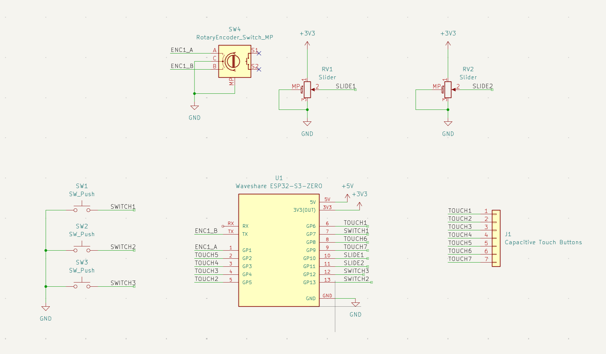
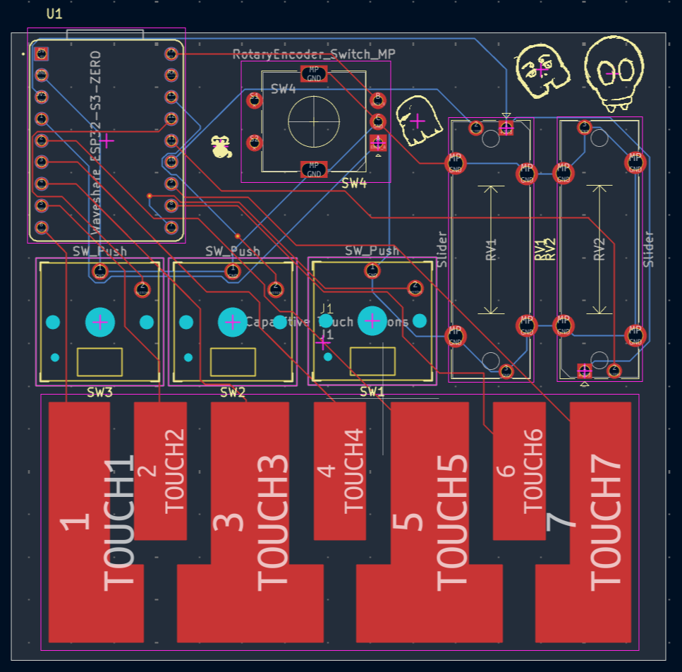
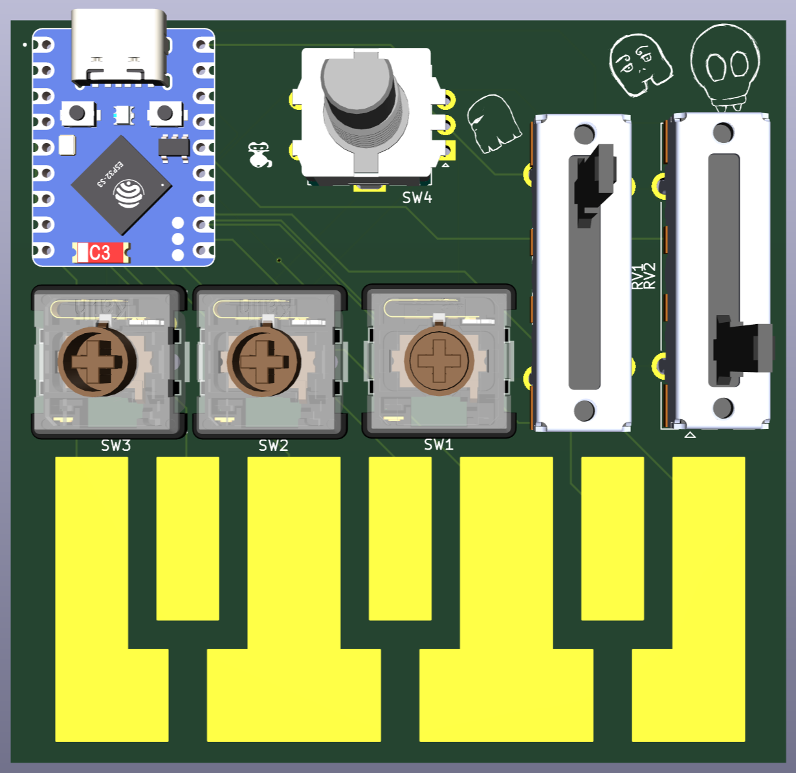

# HackClub Week 3: MIDI Keypad

A custom-designed MIDI input device featuring tactile mechanical switches, analog sliders, rotary encoders, and capacitive touch pads.

---

## Overview

This project is a custom MIDI controller built around the waveshare ESP32-S3-ZERO microcontroller. It integrates multiple types of user input: push buttons, sliders, a rotary encoder, and capacitive touch channels which allows for real-time control over music production.

---

## Schematics & Layout

### Schematic
The complete schematic details the wiring for the ESP32-S3-ZERO, rotary encoders (`SW4`), slide potentiometers (`RV1`, `RV2`), mechanical push switches (`SW1`–`SW3`), and capacitive touch headers.

### PCB Layout
The custom 2-layer printed circuit board layout designed in KiCad, routing signals across the front (`F.Cu`) and back (`B.Cu`) copper layers along with some cool art I created a while ago.

### 3D Model
A 3D render preview showcasing the physical layout and placement of components on the hardware.

---

## Features & Hardware Components

- **Microcontroller:** ESP32-S3-ZERO
- **Inputs:**
	- 3x Mechanical Push Switches (`SW1`–`SW3`)
	- 2x Slide Potentiometers / Sliders (`RV1`, `RV2`)
	- 1x Rotary Encoder with Push Switch (`SW4`)
	- Capacitive Touch Button Header (`J1`)

---

> The [Journal](./JOURNAL.md) file details my experience this week